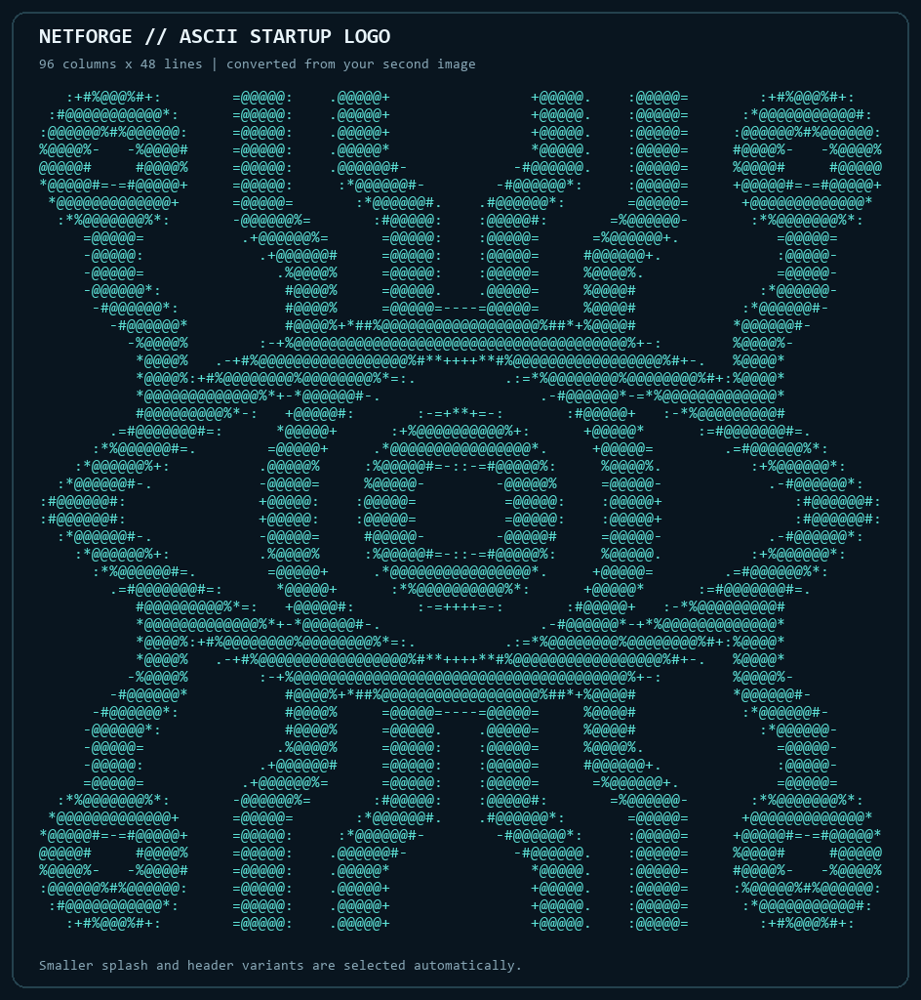

# NETFORGE

A modular C11 networking laboratory for Linux. It includes an ncurses TUI and
three independent command-line programs that share the same networking code.



## Build on Kali Linux

Clone the repository inside your Kali VM, install the dependencies, and build:

```sh
sudo apt update
sudo apt install -y git build-essential libncurses-dev
git clone https://github.com/jackkkd/netforge.git
cd netforge
make
./bin/netforge
```

If you downloaded a source archive instead, extract it and run `make` inside
its `netforge` folder after installing the dependencies above.

To download future updates, run these commands inside your existing checkout:

```sh
git pull --ff-only
make
```

No root privileges are required to run any of these programs. The TUI needs an
interactive terminal at least 80 columns wide and 28 rows high. Maximize the
terminal to display a more detailed logo and a larger activity area.

Skip the startup artwork with `./bin/netforge --no-splash`.

## Programs

| Executable | Purpose |
| --- | --- |
| `bin/netforge` | Integrated TUI: choose, configure, start, and stop each tool |
| `bin/netforge-scan` | Independent IPv4 TCP connect scanner |
| `bin/netforge-http` | Independent static HTTP server |
| `bin/netforge-packets` | Independent simulated packet stream and header parser |

Each executable accepts `--help`. The standalone tools work in ordinary shells,
redirected output, and pipelines. They do not link against ncurses.

### TCP scanner

```sh
./bin/netforge-scan 127.0.0.1 127.0.0.1 8075 8085 250 --verbose
```

Arguments are first IPv4 address, last IPv4 address, first TCP port, last TCP
port, optional timeout in milliseconds, and optional `--verbose` at the end.
Running without arguments scans localhost ports 8075-8085 with a 250 ms timeout.
Without `--verbose`, the scanner logs open ports and a summary.

Only scan systems you own or have permission to test. Ranges are limited to
256 IP addresses, 4096 ports, and 65536 probes per run. Ports must be 1-65535;
timeouts must be 50-3000 ms. TCP connections that succeed are reported as open.
Refused connections are counted separately from timeouts/unreachable targets.
A timeout does not establish whether a port is closed or filtered.

### HTTP server

```sh
./bin/netforge-http
```

The default address is `127.0.0.1:8080`. In another Kali terminal:

```sh
curl -i http://127.0.0.1:8080/
```

To choose a listen address and port:

```sh
./bin/netforge-http 0.0.0.0 8080
```

`127.0.0.1` accepts connections inside Kali. `0.0.0.0` listens on all IPv4
interfaces. To connect from the VMware host, use Kali's reachable IPv4 address;
VM networking and firewall settings must allow that connection.

Put `index.html` in the **current working directory** before starting the server
to serve your own page. Otherwise it serves its embedded welcome page. Restart
the server after changing the file. The limit is 64 KiB.

The server logs connecting clients and supports GET/HEAD on `/` and
`/index.html`, 404 responses for other paths, and 405 for unsupported methods.
It handles one client at a time with 1.5-second request and response deadlines.
Listen ports must be 1024-65535. Ctrl-C stops the standalone server.

### Packet simulation

```sh
./bin/netforge-packets 10 500 8
```

Arguments are sample count, interval in milliseconds, and malformed-sample
frequency. Defaults are 10 samples, 500 ms, and every eighth sample malformed.
Count `0` runs until Ctrl-C; malformed frequency `0` disables malformed samples.

This tool **simulates packets**. It does not capture live traffic or transmit
packets. It uses documentation IPv4 addresses and shows source/destination IPs,
TCP/UDP ports, and packet lengths. The parser checks IPv4 header checksums and
IPv4/TCP/UDP lengths. Fragment reassembly and TCP/UDP checksum verification are
outside its scope. Simulated TCP/UDP checksums are omitted.

## TUI controls

| Key | Action |
| --- | --- |
| Up/Down, then Enter | Choose and open a main-menu item |
| 1-4 on the main menu | Open the corresponding screen |
| Enter/Space on a tool screen | Start or stop that tool |
| E | Edit the selected tool's settings while it is stopped |
| Ctrl-U / Backspace | Clear a field / remove a character |
| Tab / Shift-Tab | Move forward / backward between fields |
| Enter while editing | Advance; finish after the final field |
| Escape while editing | Keep the edits and leave editing mode |
| V on the scanner screen | Toggle open-only/all-port result detail |
| B / Escape outside editing | Return to the main menu |
| H | Open help or return from help |
| P | Pause/resume the displayed activity log |
| Page Up / Page Down | Scroll recent activity |
| W | Save up to 512 recent log entries to a timestamped file |
| C | Clear recent activity history |
| Q | Stop all workers, join them, and quit |

Nothing starts automatically. Returning to the menu keeps active workers
running. Only the main thread draws ncurses windows; networking runs in workers.

For a demonstration, start HTTP first, visit its URL inside Kali, then start
the default localhost scanner. It should find TCP port 8080 open. Start the
packet simulation to show the parser alongside the other tools.

## Source layout

```text
src/
  main.c             TUI entry point and command-line options
  ui.c               Menu, settings forms, activity log, and status display
  art.c              Responsive ASCII splash and headers
  art_data.h         Embedded ASCII logo variants
  scanner.c          TCP scanner and scanner-settings validation
  http_server.c      HTTP server and server-settings validation
  packet_parser.c    IPv4 parser, simulation, and parser regression checks
  job.c              Thread lifecycle and synchronized metrics
  log.c              Thread-safe history and optional console output
  net_io.c           Nonblocking socket helpers and cancellable polling
  net_io.h           Private networking helper declarations
  util.c             Time and numeric-input helpers
include/netforge/    Public module interfaces
apps/
  scan_main.c        Standalone scanner entry point
  http_main.c        Standalone server entry point
  packets_main.c     Standalone packet-simulation entry point
  cli_common.c       CLI signal handling and worker management
tests/test_core.c    Public-API, CLI, networking, and real-terminal tests
assets/             Reference image and viewable ASCII logo files
tools/              Optional artwork-regeneration script
Makefile            Builds all executables and the shared static library
```

The TUI calls the same module APIs as the standalone entry points. Workers
receive copied settings, use synchronized metrics, and report through the
shared logger. The TUI does not spawn shell commands or competing ncurses
processes. `build/libnetforge.a` contains the reusable core; ncurses and artwork
belong to the TUI only.

## ASCII artwork

The artwork is converted from the supplied second image: an eye with circuit
branches. It uses printable ASCII characters only, with density characters
preserving the outline, iris rings, terminals, and branches. Cyan is applied by
ncurses when the terminal supports colors; monochrome terminals still work.

Startup variants are 96x48, 72x36, 48x24, and 36x18 characters, plus a compact
fallback. The full 96x48 logo needs a terminal of at least 100x54 to include its
title and controls. The largest fitting variant is selected automatically.
Tool-screen headers use 28x14, 20x10, or 14x5 versions to leave space for controls
and results. Resize handling adjusts the layout without stopping workers.

All ASCII variants are embedded at compile time. Running the binaries does not
require an assets folder, Python, or an image renderer. The PNG reference was
provided by the user; its external source/licensing has not been established.

To regenerate the art after changing the reference, optionally install Pillow
in a Python virtual environment:

```sh
python3 -m venv .venv
.venv/bin/pip install Pillow
.venv/bin/python tools/generate_logo.py
make
```

The script refreshes the ASCII text files and `src/art_data.h`.

## Verification

```sh
make check
```

This runs 41 parser/input checks and 37 integration checks. Integration tests
use loopback connections and a real pseudo-terminal. They cover HTTP statuses,
open/refused ports, conflicting listeners, worker cancellation, standalone
executables, menu navigation, logo sizes, terminal resizing, and shutdown.
Testing requires a normal Linux environment with working pseudo-terminals.

For a strict warning build:

```sh
make CFLAGS='-O2 -std=c11 -Wall -Wextra -Wpedantic -Werror -MMD -MP'
```

Verified on Linux with GCC 15.2.0 and ncurses 6.5: all 78 checks passed.
Kali is the intended deployment platform; build the sources inside your VM.
